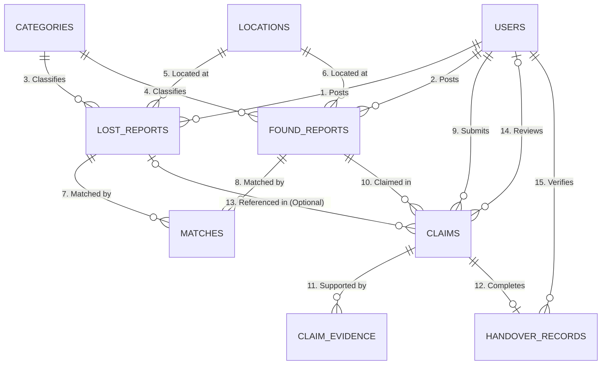

# CampusFind — Thiết Kế Cơ Sở Dữ Liệu (9 bảng và các quan hệ khóa ngoại)

## 1. Danh sách 9 bảng dữ liệu (Physical Schema)

| # | Bảng | Khóa chính (PK) | Các cột thuộc tính chính | Ràng buộc quan trọng |
|---|---|---|---|---|
| 1 | `users` | `id` (UUID) | `email`, `password_hash`, `full_name`, `role`, `contact_phone`, `is_active`, `allow_contact_sharing`, timestamps | `lower(email)` UNIQUE, `role IN ('ADMIN', 'USER')` |
| 2 | `categories` | `id` (UUID) | `name`, `description`, `is_active` | `lower(name)` UNIQUE |
| 3 | `locations` | `id` (UUID) | `name`, `description`, `is_active` | `lower(name)` UNIQUE |
| 4 | `lost_reports` | `id` (UUID) | `user_id`, `category_id`, `location_id`, `item_name`, `color`, `lost_at`, `description_public`, `private_identifiers`, `status`, timestamps | `status IN ('OPEN', 'RESOLVED', 'CLOSED')` |
| 5 | `found_reports` | `id` (UUID) | `user_id`, `category_id`, `location_id`, `item_name`, `color`, `found_at`, `description_public`, `private_identifiers`, `storage_note`, `status`, timestamps | `status IN ('OPEN', 'RETURNED', 'CLOSED')` |
| 6 | `matches` | `id` (UUID) | `lost_report_id`, `found_report_id`, `score`, `score_breakdown` (JSONB), `algorithm_version`, `calculated_at`, `lost_notified_at`, `found_notified_at`, `lost_seen_at`, `found_seen_at` | `UNIQUE(lost_report_id, found_report_id)`, `CHECK(score BETWEEN 0.0 AND 100.0)` |
| 7 | `claims` | `id` (UUID) | `found_report_id`, `lost_report_id` (NULLABLE), `claimant_id`, `reviewed_by` (NULLABLE), `status`, `reason`, `review_note`, `claimant_contact_consent`, `finder_contact_consent`, `contact_shared_at`, timestamps | `status IN ('PENDING', 'UNDER_REVIEW', 'APPROVED', 'REJECTED', 'COMPLETED', 'WITHDRAWN', 'CANCELLED')` |
| 8 | `claim_evidence` | `id` (UUID) | `claim_id`, `evidence_text`, `file_reference`, `created_at` | FK `claim_id` ON DELETE RESTRICT |
| 9 | `handover_records` | `id` (UUID) | `claim_id`, `verified_by`, `handed_over_at`, `method`, `confirmation_note`, `created_at` | `claim_id UNIQUE` (Một claim tối đa một bàn giao) |

---

## 2. Quan hệ giữa các bảng

### Diễn giải các quan hệ

1. **USERS — LOST_REPORTS (1:N)**: Một sinh viên có thể đăng nhiều tin báo mất đồ; mỗi tin mất do đúng một tài khoản đăng.
2. **USERS — FOUND_REPORTS (1:N)**: Một người nhặt có thể đăng nhiều tin nhặt được đồ; mỗi tin do đúng một tài khoản đăng.
3. **CATEGORIES — LOST_REPORTS (1:N)**: Mỗi danh mục (VD: Điện tử, Giấy tờ) phân loại cho nhiều tin báo mất.
4. **CATEGORIES — FOUND_REPORTS (1:N)**: Mỗi danh mục phân loại cho nhiều tin nhặt được đồ.
5. **LOCATIONS — LOST_REPORTS (1:N)**: Một địa điểm khuôn viên (VD: Thư viện) xuất hiện trong nhiều tin mất.
6. **LOCATIONS — FOUND_REPORTS (1:N)**: Một địa điểm xuất hiện trong nhiều tin nhặt.
7. **LOST_REPORTS — MATCHES (1:N)**: Một tin mất có thể được ghép đôi với nhiều tin nhặt khả thi (N–M được biểu diễn qua bảng trung gian `matches`).
8. **FOUND_REPORTS — MATCHES (1:N)**: Một tin nhặt có thể ghép đôi với nhiều tin mất khả thi.
9. **USERS — CLAIMS (1:N)**: Một người dùng có thể gửi nhiều yêu cầu nhận đồ (Claim) cho các tài sản khác nhau.
10. **FOUND_REPORTS — CLAIMS (1:N)**: Một tin nhặt đồ có thể nhận nhiều Claim tranh chấp từ nhiều người khác nhau.
11. **CLAIMS — CLAIM_EVIDENCE (1:N)**: Một yêu cầu nhận đồ được bổ sung bởi nhiều bằng chứng chi tiết (ảnh, mô tả đặc điểm bí mật, hóa đơn mua hàng).
12. **CLAIMS — HANDOVER_RECORDS (1:0..1)**: Mỗi claim chỉ có tối đa một biên bản bàn giao thành công.
13. **LOST_REPORTS — CLAIMS (1:N, Tùy chọn)**: Một tin báo mất có thể được liên kết tham chiếu vào nhiều Claim đối với các đồ nhặt khác nhau; trường `claims.lost_report_id` có thể NULL nếu sinh viên claim trực tiếp mà chưa kịp tạo tin mất.

14. **USERS — CLAIMS (người xét duyệt)**: `reviewed_by` là khóa ngoại tùy chọn đến `users`.
15. **USERS — HANDOVER_RECORDS (người xác nhận)**: `verified_by` là khóa ngoại bắt buộc đến `users`.
